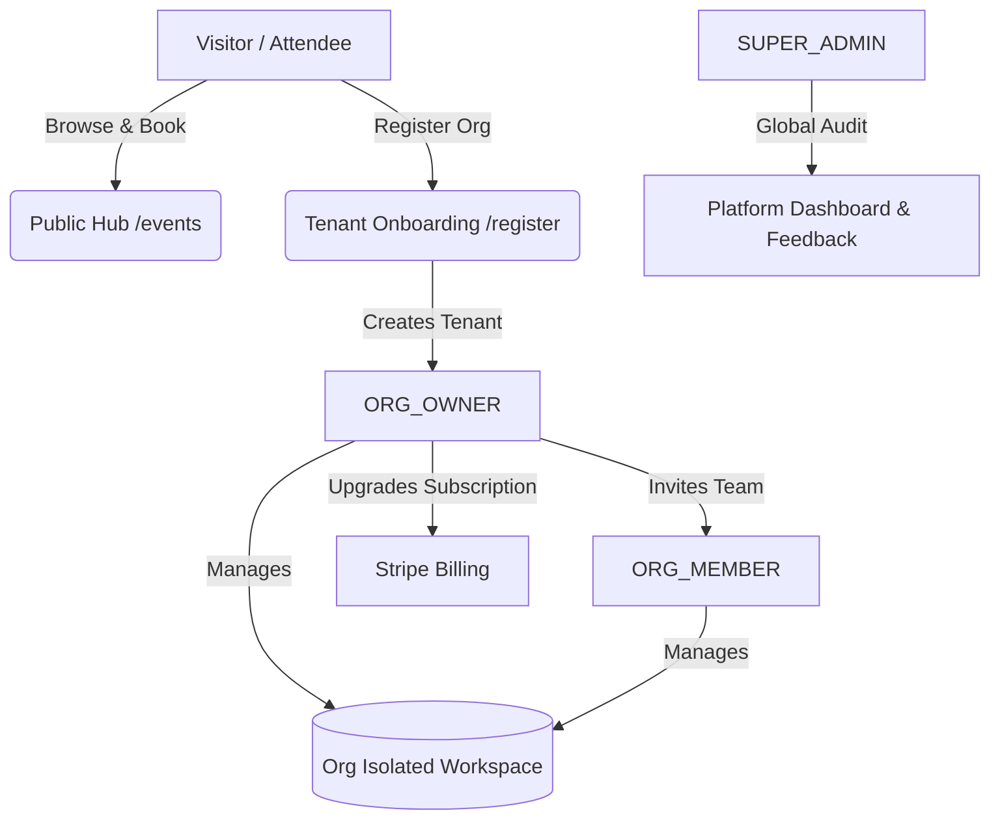
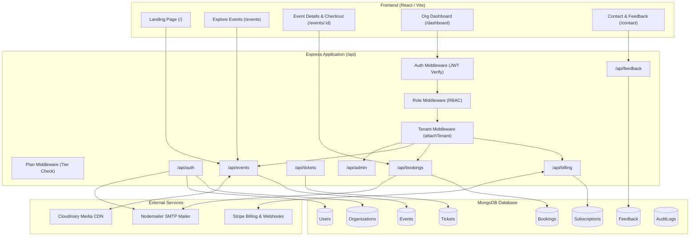
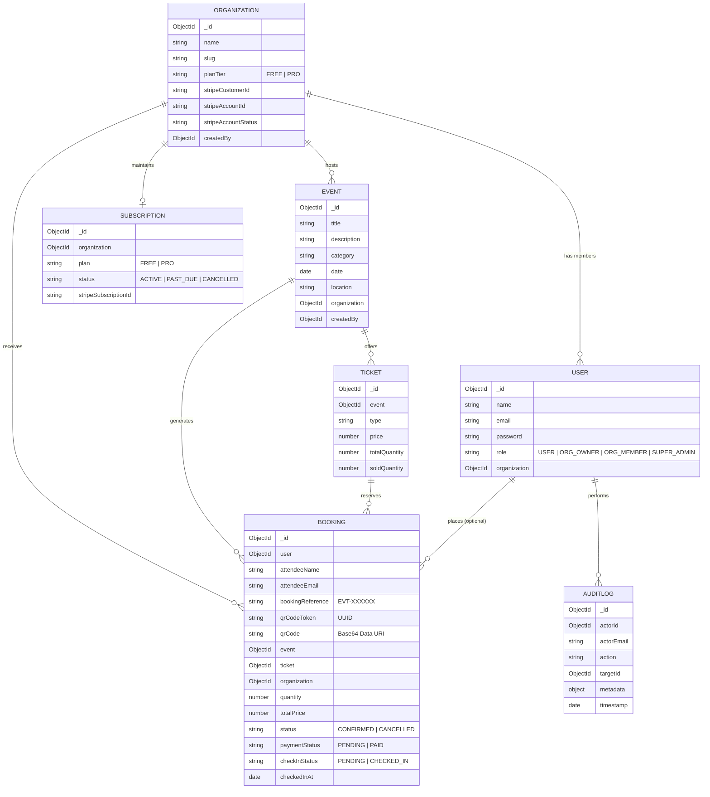

# EVENTRA — Multi-Tenant Event Management & Ticket Booking SaaS
## Comprehensive Engineering Specification Document (SRS, SDS & Test Cases)

---

## 1. Executive Project Overview & Description

### 1.1 Project Vision
**Eventra** is a high-performance, enterprise-grade, multi-tenant Software-as-a-Service (SaaS) platform built to empower event organizing businesses, agencies, and enterprises to manage, launch, monetize, and scale live events, summits, and workshops without operational friction.

Eventra operates on a dual-sided architecture:
1. **Public Event Marketplace & Attendee Booking Hub:** A public-facing portal allowing attendees to discover events across multiple organizations, choose ticket tiers (Early Bird, VIP, Regular, etc.), securely book tickets with instant stock reservation, receive automated email receipts with unique verification codes, and cancel bookings if necessary.
2. **Multi-Tenant Organization Workspace (Org Hub):** A multi-tenant workspace where event organizations operate in complete data isolation. Organizations can register, manage event schedules, configure tiered ticket pricing, invite team staff with role-based access control (RBAC), upgrade to Pro plans via Stripe Checkout, monitor real-time ticket sales and attendee rosters, and view gross revenue analytics.

### 1.2 Target Audience & Stakeholders
* **Public Attendees:** Users seeking to browse and attend concerts, tech summits, workshops, or exhibitions with instant booking and ticket confirmation.
* **Organization Owners (`ORG_OWNER`):** Business owners and founders who create the organization tenant, configure Stripe SaaS subscriptions, manage staff invitations, and track gross financial analytics.
* **Organization Staff (`ORG_MEMBER`):** Event coordinators and team members who draft, edit, and publish events, configure ticket tiers, and oversee attendee registrations.
* **Platform Super Administrators (`SUPER_ADMIN`):** Internal platform operators who monitor global cross-tenant platform health, inspect feedback/complaint submissions, and manage system integrity.

### 1.3 Key Architectural Principles
* **Strict Logical Tenant Isolation:** Every organization query is bound to `organization: req.organizationId`. Data leakage across organizations is blocked at the database and middleware layers.
* **High-Conversion Human-Grade UI:** Bespoke dark/neon aesthetic featuring custom typographic hierarchy (General Sans + Satoshi), GSAP animations, a responsive ChatGPT-style collapsible workspace sidebar, and custom vector branding.
* **Zero-Emoji Professional Standard:** UI components, system logs, and transactional email communications adhere to a strict enterprise standard without decorative emojis.
* **Atomic Concurrency Control:** Ticket inventory reservation utilizes atomic MongoDB `$inc` operations to prevent overselling.

---

## 2. Software Requirements Specification (SRS)

### 2.1 System Actors & Permissions Matrix

| Actor | Description | Key Permissions |
| :--- | :--- | :--- |
| **Guest Attendee** | Unauthenticated public visitor | Browse `/events`, view event details, execute public ticket bookings with name and email, submit feedback via `/contact`. |
| **Registered User** | Authenticated public attendee (`USER`) | View personal ticket booking history (`/bookings`), cancel personal bookings, pre-fill checkout. |
| **Org Staff** | Organization team member (`ORG_MEMBER`) | Create, update, and manage events and tickets within their own organization; view org attendee roster. |
| **Org Owner** | Organization creator/admin (`ORG_OWNER`) | All `ORG_MEMBER` capabilities + manage team invites (`/orgs/invite`), handle Stripe SaaS billing (`/billing/checkout`, `/billing/portal`), cancel attendee bookings, access organization financial analytics. |
| **Super Admin** | System administrator (`SUPER_ADMIN`) | Global cross-tenant metrics (`/admin/platform/stats`), inspect feedback and support inquiries (`/admin/feedback`), platform moderation. |



### 2.2 Functional Requirements

#### FR-1: Authentication & Organization Onboarding
* **FR-1.1:** Standard email/password registration for organization founders. Registration atomically creates a `User` (role: `ORG_OWNER`), an `Organization` with a unique slug, and a `Subscription` record initialized to the `FREE` tier.
* **FR-1.2:** JWT-based authentication storing access tokens in `localStorage` and `Authorization: Bearer <token>` headers.
* **FR-1.3:** Team invitation flow: `ORG_OWNER` dispatches email invites. Invited users register via `/join-team?token=...` and are automatically assigned to the inviter’s organization with the `ORG_MEMBER` role.
* **FR-1.4:** Secure password reset workflow via cryptographically secure random tokens and Nodemailer reset links.

#### FR-2: Multi-Tenant Event & Ticket Lifecycle
* **FR-2.1:** Organizations can create, update, and delete events with title, description, category, date, location, and Cloudinary-backed poster images.
* **FR-2.2:** Each event supports multiple ticket tiers (e.g., General Admission, VIP, Early Bird) with custom pricing and total quantity limits.
* **FR-2.3:** Tier restriction: Organizations on the `FREE` plan tier are restricted to a maximum of 3 active events. Creating additional events requires upgrading to `PRO`.

#### FR-3: Public Attendee Booking Flow (Pay at Venue Model)
* **FR-3.1:** The `/events` page lists published events across all organizations with real-time text search and category filters.
* **FR-3.2:** Public event detail page (`/events/:id`) displays event information, active ticket tiers, price, and live availability.
* **FR-3.3:** Public checkout utilizes a "Reserve Now, Pay at Venue" model with zero online credit card friction. Clearly states "Total Due at Venue".
* **FR-3.4:** Backend booking endpoint (`POST /api/bookings`) atomically decrements inventory (`$inc: { soldQuantity: quantity }`), generates a unique `bookingReference` (e.g. `EVT-XXXXXX`), a unique `qrCodeToken` (UUID), and generates a Base64 QR code image using `qrcode`.
* **FR-3.5:** Initial state recorded as `paymentStatus: "PENDING"` and `checkInStatus: "PENDING"`.
* **FR-3.6:** Dispatches an automated, emoji-free HTML confirmation email via Nodemailer containing event details, amount due at venue, embedded QR code pass, and arrival instructions.

#### FR-4: Organization Attendee Management & QR Scanner
* **FR-4.1:** Dedicated "Attendees" tab in the Org Dashboard (`/dashboard?tab=attendees`) displaying attendee records strictly scoped to `req.organizationId`.
* **FR-4.2:** Table displays: Booking Reference, Attendee Name, Email, Event Name, Tier, Quantity, Total Due, `paymentStatus` (PENDING/PAID badges), `checkInStatus` (PENDING/CHECKED_IN badges), and action buttons.
* **FR-4.3:** "Mark as Paid" action allows `ORG_OWNER` and staff to manually mark reservations as `PAID` (`PATCH /api/bookings/org/:id/mark-paid`).
* **FR-4.4:** "Cancel Booking" action cancels reservations and restores inventory (`PATCH /api/bookings/org/:id/cancel`).
* **FR-4.5:** Integrated QR Ticket Scanner page (`/dashboard?tab=scanner`) utilizing `html5-qrcode` for live device camera scanning, plus instant manual token input fallback.
* **FR-4.6:** Ticket verification endpoint (`POST /api/bookings/verify-ticket`) validates ticket authenticity, verifies tenant ownership, prevents duplicate check-ins, marks status as `CHECKED_IN` and `PAID`, and logs audit actions.

#### FR-5: SaaS Billing & Subscription Management
* **FR-5.1:** Organizations can upgrade from `FREE` ($0/mo) to `PRO` ($29/mo) via Stripe Checkout Session (`POST /api/billing/checkout`).
* **FR-5.2:** Stripe Webhook endpoint (`POST /api/billing/webhook`) processes `checkout.session.completed`, `customer.subscription.updated`, and `customer.subscription.deleted` to keep `Organization.planTier` and `Subscription.status` synchronized.
* **FR-5.3:** Stripe Customer Portal (`GET /api/billing/portal`) allows org owners to manage credit cards, view invoices, or cancel subscriptions.

#### FR-6: Feedback, Inquiries, and Contact System
* **FR-6.1:** Public submission via `/contact` page or footer modal (`POST /api/feedback`) capturing Name, Email, Type (`GENERAL`, `COMPLAINT`, `BUG`, `FEATURE_REQUEST`), and Message.
* **FR-6.2:** Protected moderation endpoint (`GET /api/admin/feedback`) accessible only by `SUPER_ADMIN`.

#### FR-7: Account Deletion Cascade
* **FR-7.1:** Authenticated users can delete their own account via `DELETE /api/auth/account`.
* **FR-7.2:** Deleting an `ORG_OWNER` cascades to delete their Organization, all Events, all Tickets, all Bookings, and their Subscription record. All `ORG_MEMBER` users belonging to the deleted organization are downgraded to role `USER` with their `organization` field set to `null`.
* **FR-7.3:** Deleting a regular `USER` or `ORG_MEMBER` deletes only the user record and their personal bookings. Organization data remains intact.
* **FR-7.4:** All deletion operations are logged to the Audit Log.

#### FR-8: Audit Logging
* **FR-8.1:** An `AuditLog` model tracks sensitive platform actions including: user registration, event creation/deletion, booking cancellation, ticket verification/check-in, mark-as-paid, team invitations, plan upgrades, and account deletions.
* **FR-8.2:** Each audit entry records `actorId`, `actorEmail`, `action` (string identifier), `targetId` (the affected resource), freeform `metadata` (object), and `timestamp`.
* **FR-8.3:** `SUPER_ADMIN` users can query all audit logs via `GET /api/admin/audit-logs` with pagination support.

### 2.3 Non-Functional Requirements (NFR)
* **NFR-1 (Security):** Passwords hashed with bcrypt (salt rounds: 10). JWT signed with 256-bit secret. Strict CORS whitelisting (`http://localhost:5173`).
* **NFR-2 (Performance):** Average API response time under 150ms on indexed MongoDB lookups. Static frontend bundles minified via Vite Rolldown/ESBuild.
* **NFR-3 (Data Integrity):** Unique compound indexes on `[event, type]` for tickets and unique constraint on `bookingReference`.
* **NFR-4 (Usability & Responsiveness):** Responsive design functioning from 320px mobile screens to 2560px 4K displays. Collapsible sidebar with state persistence in `localStorage`. Zero decorative emojis across all interfaces and emails. Typography must use Satoshi (Headings) and General Sans (Body) loaded from Fontshare CDN. UI must utilize GSAP for scroll-triggered animations and maintain the dark/neon aesthetic throughout all pages and components.

---

## 3. Software Design Specification (SDS)

### 3.1 Technology Stack

```
Frontend:
├── Framework: React 18 + Vite
├── Routing: React Router DOM v6
├── Styling: Custom Modern CSS + Lucide React Icons
├── Typography: General Sans (Body) + Satoshi (Headings) + Instrument Serif (Hero)
├── Animations: GSAP (GreenSock) + @gsap/react
├── QR Code Scanner: html5-qrcode (Device camera-based QR reader)
└── HTTP Client: Axios (with JWT interceptors)

Backend:
├── Runtime: Node.js (v20+)
├── Web Framework: Express.js (v5)
├── Database: MongoDB + Mongoose ODM (v9)
├── Payment Gateway: Stripe Node SDK (v23) — SaaS billing only
├── Image Storage: Cloudinary + Multer Storage Cloudinary
├── Email Service: Nodemailer (SMTP / Gmail App Password)
├── QR Code Generation: qrcode (Base64/SVG) + uuid (Token generation)
└── Authentication: JSON Web Tokens (jsonwebtoken) + bcrypt
```

### 3.2 System Architecture Diagram



### 3.3 Data Models & Schemas



#### Detailed Schema Definitions

##### 1. Organization Model (`backend/models/organization.model.js`)
```javascript
const organizationSchema = new mongoose.Schema({
    name: { type: String, required: true, trim: true },
    slug: { type: String, required: true, unique: true, lowercase: true, trim: true },
    planTier: { type: String, enum: ["FREE", "PRO"], default: "FREE" },
    stripeCustomerId: { type: String, default: null },
    stripeAccountId: { type: String, default: null },
    stripeAccountStatus: { type: String, default: null },
    createdBy: { type: mongoose.Schema.Types.ObjectId, ref: "User", required: true }
}, { timestamps: true });
```

##### 2. Booking Model (`backend/models/booking.model.js`)
```javascript
const bookingSchema = new mongoose.Schema({
    user: { type: mongoose.Schema.Types.ObjectId, ref: "User", default: null },
    attendeeName: { type: String, required: true, trim: true },
    attendeeEmail: { type: String, required: true, lowercase: true, trim: true },
    bookingReference: { type: String, required: true, unique: true, uppercase: true },
    qrCodeToken: { type: String, unique: true },
    qrCode: { type: String },
    event: { type: mongoose.Schema.Types.ObjectId, ref: "Event", required: true },
    ticket: { type: mongoose.Schema.Types.ObjectId, ref: "Ticket", required: true },
    organization: { type: mongoose.Schema.Types.ObjectId, ref: "Organization", required: true },
    quantity: { type: Number, required: true, min: 1 },
    totalPrice: { type: Number, required: true, min: 0 },
    status: { type: String, enum: ["CONFIRMED", "CANCELLED"], default: "CONFIRMED" },
    paymentStatus: { type: String, enum: ["PENDING", "PAID"], default: "PENDING" },
    checkInStatus: { type: String, enum: ["PENDING", "CHECKED_IN"], default: "PENDING" },
    checkedInAt: { type: Date, default: null }
}, { timestamps: true });
bookingSchema.index({ organization: 1, event: 1 });
```

##### 3. Ticket Model (`backend/models/ticket.model.js`)
```javascript
const ticketSchema = new mongoose.Schema({
    event: { type: mongoose.Schema.Types.ObjectId, ref: "Event", required: true },
    type: { type: String, required: true, trim: true },
    price: { type: Number, required: true, min: 0 },
    totalQuantity: { type: Number, required: true, min: 1 },
    soldQuantity: { type: Number, default: 0, min: 0 }
}, { timestamps: true });
ticketSchema.index({ event: 1, type: 1 }, { unique: true });
```

##### 4. AuditLog Model (`backend/models/audit-log.model.js`)
```javascript
const auditLogSchema = new mongoose.Schema({
    actorId: { type: mongoose.Schema.Types.ObjectId, ref: "User", required: true },
    actorEmail: { type: String, required: true },
    action: { type: String, required: true },
    targetId: { type: mongoose.Schema.Types.ObjectId, default: null },
    metadata: { type: mongoose.Schema.Types.Mixed, default: {} },
    timestamp: { type: Date, default: Date.now }
});
auditLogSchema.index({ actorId: 1, timestamp: -1 });
```

### 3.3.1 Database Indexes Reference

| Collection | Index Fields | Type | Purpose |
| :--- | :--- | :--- | :--- |
| `organizations` | `{ slug: 1 }` | Unique | Fast slug-based tenant lookup |
| `events` | `{ organization: 1, date: -1 }` | Compound | Org-scoped event queries sorted by date |
| `bookings` | `{ organization: 1, event: 1 }` | Compound | Org attendee dashboard aggregation queries |
| `bookings` | `{ bookingReference: 1 }` | Unique | Booking reference lookup |
| `bookings` | `{ qrCodeToken: 1 }` | Unique | QR scanner ticket verification |
| `tickets` | `{ event: 1, type: 1 }` | Compound Unique | Prevent duplicate tier types per event |
| `users` | `{ email: 1 }` | Unique | Login and invite deduplication |
| `auditlogs` | `{ actorId: 1, timestamp: -1 }` | Compound | Actor-scoped audit log queries |

### 3.4 Key Middleware & Multi-Tenant Isolation

1. **Authentication Middleware (`auth.middleware.js`):**
   Extracts `Authorization: Bearer <token>`, verifies JWT against `process.env.JWT_SECRET`, loads user, and attaches `req.user = { userId, email, role, organizationId }`.
2. **Tenant Scoping Middleware (`tenant.middleware.js`):**
   Guarantees that `req.organizationId = req.user.organizationId`. If the user is unassigned to an organization, the request is rejected with `403 Forbidden: No organization context associated with this account`.
3. **Plan Tier Enforcement Middleware (`plan.middleware.js`):**
   Intercepts event creation requests. Checks if `Organization.planTier === "FREE"`. If active events $\ge 3$, blocks creation with: `403 Forbidden: Free plan limit reached (max 3 events). Upgrade to PRO to create unlimited events`.
4. **Optional Authentication Helper (`optionalAuth`):**
   Inspects `Authorization` headers. If present, decodes user credentials; if absent, allows public guest access to proceed for ticket booking and event exploration.

### 3.5 Core API Route Reference

| Method | Endpoint | Access | Purpose |
| :--- | :--- | :--- | :--- |
| `POST` | `/api/auth/register` | Public | Register user + organization + subscription |
| `POST` | `/api/auth/login` | Public | Authenticate user, return JWT |
| `GET` | `/api/events` | Public | List all public events with category filters |
| `GET` | `/api/events/:id` | Public | Get single event details with organizer info |
| `GET` | `/api/events/org/my-events` | `ORG_OWNER`, `ORG_MEMBER` | Get events strictly for logged-in organization |
| `POST` | `/api/events` | `ORG_OWNER`, `ORG_MEMBER` | Create event (enforces plan limit) |
| `GET` | `/api/tickets/event/:id` | Public | Get ticket tiers for an event |
| `POST` | `/api/bookings` | Public / Auth | Book tickets with atomic stock decrement |
| `GET` | `/api/bookings/org` | `ORG_OWNER`, `ORG_MEMBER` | Organization attendee bookings list |
| `PATCH`| `/api/bookings/org/:id/cancel`| `ORG_OWNER`, `ORG_MEMBER` | Cancel booking & restore ticket inventory |
| `PATCH`| `/api/bookings/org/:id/mark-paid`| `ORG_OWNER`, `ORG_MEMBER` | Manually mark a reservation as PAID |
| `POST` | `/api/bookings/verify-ticket` | `ORG_OWNER`, `ORG_MEMBER` | QR scan verification — marks CHECKED_IN + PAID |
| `GET` | `/api/admin/org/stats` | `ORG_OWNER`, `ORG_MEMBER` | Aggregated org metrics (tickets sold, revenue) |
| `POST` | `/api/billing/checkout` | `ORG_OWNER` | Generate Stripe $29/mo checkout session |
| `POST` | `/api/billing/webhook` | Public (Stripe signed) | Stripe event ingestion (raw body) |
| `POST` | `/api/feedback` | Public | Submit contact message / bug report |
| `GET` | `/api/admin/feedback` | `SUPER_ADMIN` | Inspect all platform feedback submissions |
| `GET` | `/api/admin/audit-logs` | `SUPER_ADMIN` | Paginated audit log of all sensitive actions |
| `DELETE`| `/api/auth/account` | Authenticated | Delete own account with full cascade |

---

## 4. Test Cases & Verification Matrix

The test matrix covers automated verification and edge-case testing conducted across the platform.

### 4.1 Authentication & Multi-Tenancy

| Test ID | Test Scenario | Steps | Expected Result | Status |
| :--- | :--- | :--- | :--- | :--- |
| **TC-AUTH-01** | Org Owner Registration | `POST /api/auth/register` with org name, user email, password | Creates User (`ORG_OWNER`), Org (`FREE`), Subscription (`ACTIVE`). Returns JWT. | **PASS** |
| **TC-AUTH-02** | Login Authentication | `POST /api/auth/login` with correct credentials | Returns JWT with `userId`, `role`, and `organizationId`. | **PASS** |
| **TC-TENANT-01** | Cross-Tenant Data Isolation | User from Org A queries `/api/bookings/org` | Returns only bookings belonging to Org A. Org B data is not returned. | **PASS** |
| **TC-TENANT-02** | Unauthorized Org Access | Request `/api/admin/org/stats` without JWT | Returns `401 Unauthorized: No token provided`. | **PASS** |

### 4.2 Event & Ticket Management

| Test ID | Test Scenario | Steps | Expected Result | Status |
| :--- | :--- | :--- | :--- | :--- |
| **TC-EVT-01** | Create Event under Org | `POST /api/events` with valid title, date, location | Event saved with `organization: req.organizationId`. | **PASS** |
| **TC-EVT-02** | Free Tier Limit Enforcement | Org on `FREE` tier attempts to create 4th event | Middleware returns `403 Forbidden: Free plan limit reached`. | **PASS** |
| **TC-TCK-01** | Create Ticket Tiers | `POST /api/tickets` with type, price, totalQuantity | Tier created and linked to event with `soldQuantity: 0`. | **PASS** |
| **TC-TCK-02** | Prevent Duplicate Tier Type | Attempt to create two "VIP" tiers on same event | Compound unique index blocks duplicate with `400 Bad Request`. | **PASS** |

### 4.3 Public Attendee Booking & Stock Management

| Test ID | Test Scenario | Steps | Expected Result | Status |
| :--- | :--- | :--- | :--- | :--- |
| **TC-BOOK-01** | Public Guest Checkout (Pay at Venue) | `POST /api/bookings` with name, email, eventId, ticketId, quantity: 2 | Booking created with `status: CONFIRMED`, `paymentStatus: PENDING`, `checkInStatus: PENDING`, and `EVT-XXXXXX` reference. No Stripe redirect triggered. | **PASS** |
| **TC-BOOK-02** | Stock Decrement | Check `soldQuantity` before and after TC-BOOK-01 | `soldQuantity` increments atomically by 2. | **PASS** |
| **TC-BOOK-03** | Overselling Prevention | Attempt to book 50 tickets when only 5 remain | Request rejected with `400: Not enough tickets available`. Stock unaffected. | **PASS** |
| **TC-BOOK-04** | Confirmation Email with QR Code | Inspect Nodemailer dispatch on successful booking | Sends emoji-free HTML email containing reference ID, event details, total amount due at venue, and embedded Base64 QR code image. | **PASS** |
| **TC-BOOK-05** | QR Code Token Generation | Inspect saved booking document after TC-BOOK-01 | `qrCodeToken` is a valid UUID, `qrCode` is a non-empty Base64 data URI string. | **PASS** |

### 4.4 Org Attendee Dashboard & Cancellation

| Test ID | Test Scenario | Steps | Expected Result | Status |
| :--- | :--- | :--- | :--- | :--- |
| **TC-ORG-01** | Attendee Roster Visibility | `GET /api/bookings/org` with Org Owner token | Returns list of attendee names, emails, references, amounts, `paymentStatus`, and `checkInStatus`. | **PASS** |
| **TC-ORG-02** | Org Booking Cancellation | `PATCH /api/bookings/org/:id/cancel` | Booking status set to `CANCELLED`. Ticket `soldQuantity` decremented by quantity. | **PASS** |
| **TC-ORG-03** | Prevent Double Cancellation | Call cancel endpoint a second time on same booking | Returns `400: This booking has already been cancelled`. | **PASS** |
| **TC-ORG-04** | Real-Time KPI Stats | `GET /api/admin/org/stats` | Aggregation calculates accurate `ticketsSold` and `revenue` for confirmed bookings. | **PASS** |
| **TC-ORG-05** | QR Scanner Check-In | `POST /api/bookings/verify-ticket` with valid `qrCodeToken` from org's event | Booking `checkInStatus` set to `CHECKED_IN`, `paymentStatus` set to `PAID`, `checkedInAt` timestamp recorded. Second scan returns `400: Ticket already checked in`. | **PASS** |
| **TC-ORG-06** | Manual Mark as Paid | `PATCH /api/bookings/org/:id/mark-paid` with `ORG_OWNER` token | Booking `paymentStatus` updated to `PAID`. Audit log entry created. | **PASS** |

### 4.5 Account Deletion Cascade & Audit Logging

| Test ID | Test Scenario | Steps | Expected Result | Status |
| :--- | :--- | :--- | :--- | :--- |
| **TC-DEL-01** | ORG_OWNER Account Deletion Cascade | `DELETE /api/auth/account` as `ORG_OWNER` | User, Organization, all Events, all Tickets, all Bookings, and Subscription are deleted. All `ORG_MEMBER` users are downgraded to `USER` with `organization: null`. | **PASS** |
| **TC-DEL-02** | Regular User Deletion | `DELETE /api/auth/account` as `USER` | Only the user record and their personal bookings are deleted. No org or event data affected. | **PASS** |
| **TC-AUDIT-01** | Audit Log Coverage | Trigger event creation, booking cancellation, and team invite | Corresponding `AuditLog` entries exist in DB with correct `actorEmail`, `action`, and `targetId`. | **PASS** |
| **TC-AUDIT-02** | Super Admin Audit Access | `GET /api/admin/audit-logs` as `SUPER_ADMIN` | Returns paginated audit log entries. Access denied for `ORG_OWNER` with `403`. | **PASS** |

### 4.6 SaaS Billing & Feedback

| Test ID | Test Scenario | Steps | Expected Result | Status |
| :--- | :--- | :--- | :--- | :--- |
| **TC-BILL-01** | Stripe Checkout Init | `POST /api/billing/checkout` | Generates Stripe Session URL for $29/mo Pro upgrade. | **PASS** |
| **TC-BILL-02** | Stripe Customer Portal | `GET /api/billing/portal` | Generates Stripe Billing Portal session for customer ID. | **PASS** |
| **TC-FEED-01** | Public Feedback Submission | `POST /api/feedback` with name, email, type, message | Saves record with `status: PENDING`. Returns success message. | **PASS** |
| **TC-FEED-02** | Super Admin Feedback Audit | `GET /api/admin/feedback` as `SUPER_ADMIN` | Returns all submissions. Access rejected for `ORG_OWNER` with `403`. | **PASS** |

---

## 5. Deployment, Environment Configuration & Operational Runbook

### 5.1 Environment Variables Matrix (`backend/.env`)

```ini
PORT=3000
MONGODB_URI=mongodb+srv://<user>:<password>@cluster0.mongodb.net/eventhub?retryWrites=true&w=majority
JWT_SECRET=your_super_secret_jwt_key_here
CLIENT_URL=http://localhost:5173

# Email Service (Nodemailer SMTP)
EMAIL_SERVICE=gmail
EMAIL_USER=your_email@gmail.com
EMAIL_PASS=your_gmail_app_password
EMAIL_FROM=Eventra <no-reply@eventra.com>

# Cloudinary Media CDN
CLOUDINARY_CLOUD_NAME=your_cloud_name
CLOUDINARY_API_KEY=your_cloudinary_key
CLOUDINARY_API_SECRET=your_cloudinary_secret

# Stripe Billing (Used ONLY for org SaaS subscription billing — PRO plan upgrade at $29/mo)
# NOTE: Stripe is NOT used for public ticket checkout. Ticket bookings use the "Pay at Venue" model.
STRIPE_SECRET_KEY=sk_test_...
STRIPE_WEBHOOK_SECRET=whsec_...
STRIPE_PRICE_PRO=price_...
```

### 5.2 Launch and Verification Commands

#### Start Backend Service
```bash
cd backend
npm install
node app.js
# Verified output:
# MongoDB connected successfully
# Eventra API running on port 3000
# Email server ready
```

#### Start Frontend Client
```bash
cd frontend
npm install
npm run dev
# Running on http://localhost:5173
```

#### Production Build Verification
```bash
cd frontend
npm run build
# vite build output:
# ✓ 2199 modules transformed
# dist/index.html 1.24 kB
# ✓ built in 2.96s (0 errors)
```

#### Phase 5 Automated Verification Suite
```bash
cd backend
node scripts/test-phase5-verification.js
# Output:
# TEST 1: Pay at Venue Booking — PASSED (paymentStatus: PENDING, no Stripe redirect)
# TEST 2: Org Dashboard + Mark as Paid — PASSED
# TEST 3: QR Scanner Check-In + Duplicate Prevention — PASSED
# TEST 4: Audit Logs — PASSED
# TEST 5: Account Deletion Cascade — PASSED
# ALL 5 PHASE 5 TESTS PASSED
```

#### Automated End-to-End Test Suite Execution
```bash
cd backend
node scripts/test-attendee-flow.js
# Output:
# ✓ Public events retrieved
# ✓ Booking confirmed (EVT-XXXXXX)
# ✓ Ticket stock decremented
# ✓ Verified in Org Attendee Dashboard
# ✓ Org KPI revenue and tickets sold verified
# ✓ Org cancellation executed & ticket inventory restored
# ALL TESTS PASSED: PUBLIC BOOKING & ORG DASHBOARD FLOW VERIFIED 100%
```

---
*Document Version: 2.0.0 — Eventra Engineering Specification (Phase 5: Pay at Venue, QR Check-In, Audit Logging, Account Deletion Cascade)*

